<!--
  ==========  BEFORE YOU PUBLISH, REPLACE  ==========
  1. YOUR_USERNAME          -> your GitHub username
  2. YOUR-LINKEDIN-URL      -> your LinkedIn profile link
  3. YOUR-EMAIL@gmail.com   -> your real email
  4. Project links below    -> your live demos and repos
  5. Name / project text    -> these live inside the files in /assets (send them to me and I'll regenerate)
-->

  

  

  

 

I'm a **Physics & Computer Science graduate (2025)** focused on front-end development. I build responsive interfaces with HTML, CSS/SCSS, JavaScript and TypeScript, speed up my workflow with Gulp and Git, and I'm currently learning **Angular**.

My science background taught me to break big problems into small steps, and I use the same approach on every project.

- 📍 Cairo, Egypt
- 🔭 Currently learning Angular
- 📫 Open to junior Front-End opportunities <!-- delete this line if you're not looking for work -->

  

  

 

  

<a href="https://YOUR_USERNAME.github.io/project-one">Live Demo</a> &nbsp;•&nbsp; <a href="https://github.com/YOUR_USERNAME/project-one">Source Code</a>

 

<a href="https://YOUR_USERNAME.github.io/project-two">Live Demo</a> &nbsp;•&nbsp; <a href="https://github.com/YOUR_USERNAME/project-two">Source Code</a>

 

<a href="https://YOUR_USERNAME.github.io/project-three">Live Demo</a> &nbsp;•&nbsp; <a href="https://github.com/YOUR_USERNAME/project-three">Source Code</a>

 

  

Open to questions, collaboration and new opportunities.

